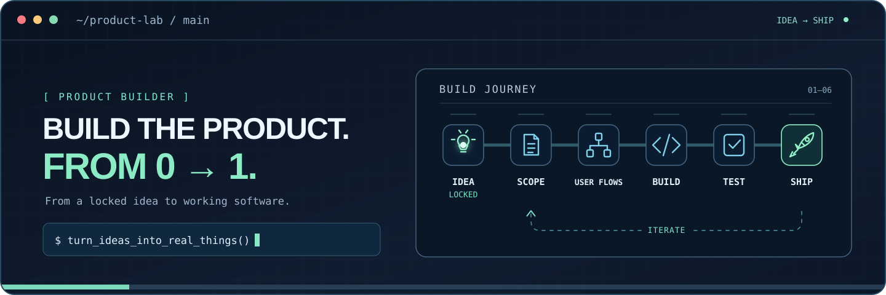

### Shrey Shah
**Product Support Specialist · Crypto-fintech · Product-minded builder**

I work where **APIs, data, user problems, and product decisions** meet. I enjoy getting from an unclear symptom to a clear system-level explanation — and then building something better.

[**Portfolio ↗**](https://shrey.si) &nbsp;·&nbsp; [**MATHLAB ↗**](https://mathlablive.com) &nbsp;·&nbsp; [**LinkedIn ↗**](https://www.linkedin.com/in/shreyshah263/) &nbsp;·&nbsp; [**Email ↗**](mailto:shreyshahsds@gmail.com)

---

### Selected work

| Project | What it explores |
| :-- | :-- |
| **[MATHLAB ↗](https://mathlablive.com)** | Practice flows and learning experiences, designed around how students actually use the product. |
| **[shrey.si ↗](https://shrey.si)** · [source](https://github.com/shreyshah2003/shrey-portfolio) | A personal website built with HTML, CSS, JavaScript, and custom interactions. |
| **[100xDevs ↗](https://github.com/shreyshah2003/100xDevs)** | My public web-development and DSA learning log. |

### Under the hood

| I work on | With |
| :-- | :-- |
| **Tracing systems** | REST APIs · Postman · Datadog · Linux/Bash |
| **Asking the data** | SQL · PostgreSQL · AWS Athena · Python |
| **Building & collaborating** | JavaScript · Git/GitHub · Jira · technical documentation |
| **Understanding the domain** | Payments · Bitcoin/Lightning · operational risk · product workflows |

<b>🕹️ A tiny debugging side quest</b>

A payment endpoint returns `HTTP 200` with `{"status":"failed"}`. Bug or expected behaviour?

Uncover the answer

**It depends on the API contract.** The HTTP status can describe the request's success while the response body reports a failed payment. Check the documented contract, payment state machine, frontend status handling, and relevant logs before calling it a bug.

Rule of thumb: reproduce first, assume later.

Illustrated process, not a live project-status tracker. Professional investigations and customer data remain private.
