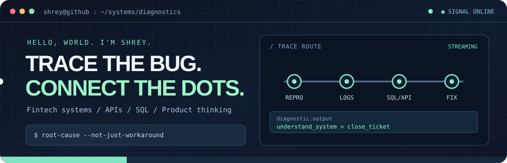
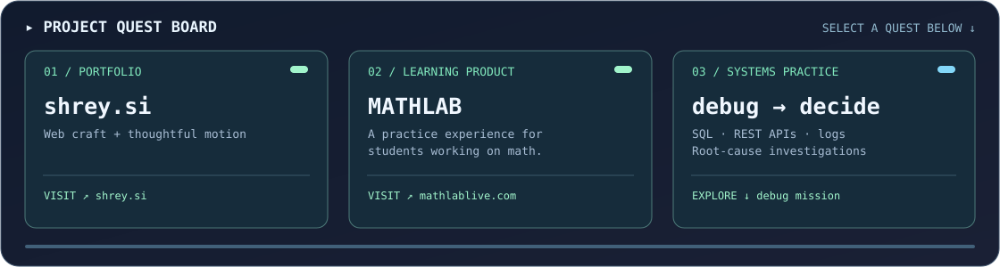

<div align="center">



### Shrey Shah
**Technical Support Engineer · Fintech Systems · Data & Product Thinking**

*Some people see an error message. I want the logs, the API response, and the SQL query behind it.*

[**Portfolio ↗**](https://shrey.si) &nbsp;·&nbsp; [**MATHLAB ↗**](https://mathlablive.com) &nbsp;·&nbsp; [**LinkedIn ↗**](https://www.linkedin.com/in/shreyshah263/) &nbsp;·&nbsp; [**Email ↗**](mailto:shreyshahsds@gmail.com)

</div>

---

### `> whoami`

I work in **crypto-fintech**, where technical systems, customer behaviour, and business decisions intersect.

At [Speed](https://www.speed.app/), I investigate transaction and product issues, reproduce edge cases, trace behaviour through **logs, APIs, and databases**, and translate findings into actionable engineering and product work.

**My favourite kind of puzzle:** the user says one thing, the API says another, and the database knows why.

### `> select_quest`



| Quest | Explore | Technical angle |
| :-- | :-- | :-- |
| **01 · shrey.si** | [Visit portfolio ↗](https://shrey.si) · [Source ↗](https://github.com/shreyshah2003/shrey-portfolio) | Vanilla HTML/CSS/JS, interaction and motion |
| **02 · MATHLAB** | [mathlablive.com ↗](https://mathlablive.com) | Learning experience, practice flows and product logic |
| **03 · Systems debugging** | [Play the debugging challenge ↓](#-mini-game-find-the-bug) | API semantics, error handling and root-cause thinking |
| **04 · 100xDevs** | [Learning log ↗](https://github.com/shreyshah2003/100xDevs) | Web-development and DSA exercises |

> A GitHub README is a window into how I think, not a production-uptime scoreboard. Projects and learning exercises are labelled accordingly.

### `> ls ./toolbox`

| Mode | Tools |
| :-- | :-- |
| **DATA** | SQL · PostgreSQL · AWS Athena · Python · Excel/Sheets |
| **TRACE** | REST APIs · Postman · JSON · Datadog |
| **SHIP** | Git/GitHub · Linux/Bash · Jira · Technical documentation |
| **DOMAIN** | Payments · Bitcoin/Lightning · Transaction investigations · Risk workflows |
| **EXPLORE** | HTML/CSS/JavaScript · Django · Flutter · OpenCV |

### `> mini-game: find-the-bug`

**Mission:** An API returns `200 OK`, but the frontend displays *Payment failed*. You see:

```json
HTTP/1.1 200 OK
{
  "status": "failed",
  "payment_id": "demo_123",
  "failure_reason": "insufficient_funds"
}
```

**Question:** Is the API response necessarily contradictory? What's your first debugging move?

<details>
<summary>🎮 Reveal diagnostic hint</summary>

An HTTP 200 may indicate the *request itself* succeeded even if the underlying business operation failed. Ask whether the API's documented contract intentionally separates transport success from payment status. Compare the HTTP code, response schema, frontend mapping, and any async payment-state transitions.

</details>

<details>
<summary>✅ Reveal resolution</summary>

**Not necessarily a contradiction.** Confirm the API contract before treating `200` as a bug. Trace the payment's state machine, inspect the transaction and event logs, and check whether the frontend incorrectly assumes `2xx = paid`. The fix could be in client status handling, API semantics, or documentation—depending on the intended contract.

*The trick is to debug the system, not guess from a single status code.*

</details>

### `> operating_principles`

```text
01  Reproduce before speculating.
02  Follow the evidence across systems.
03  Separate symptoms from causes.
04  Document for the next person.
05  Build tools people actually need.
```

<div align="center">

**Less buzzword bingo. More reproducible problems.**

[shrey.si](https://shrey.si) · [mathlablive.com](https://mathlablive.com) · [All repositories](https://github.com/shreyshah2003?tab=repositories)

<sub>Original motion graphics in this repository. No external stats service or artificial leaderboard numbers.</sub>

</div>
